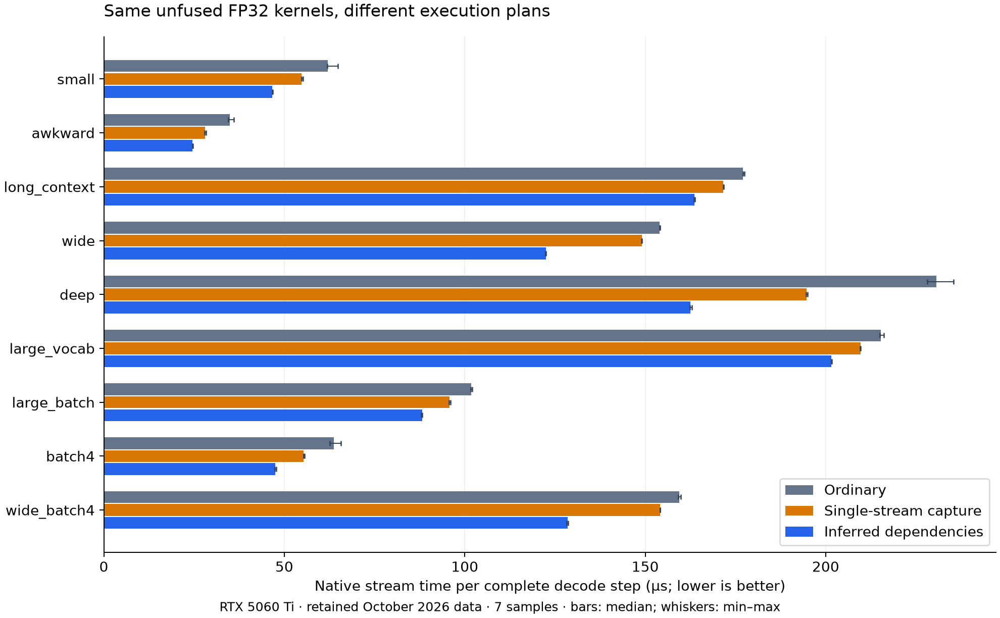
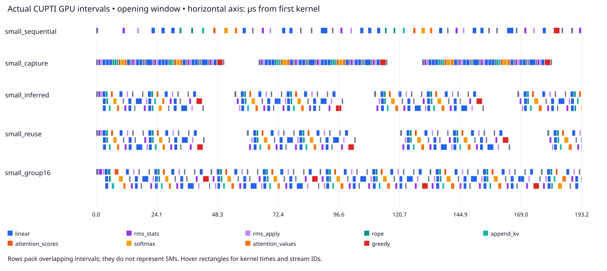
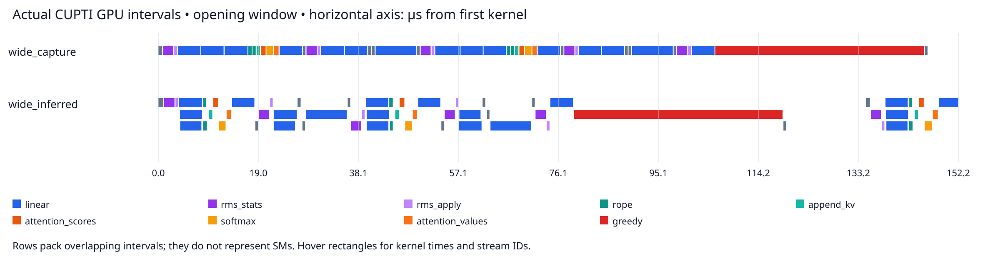
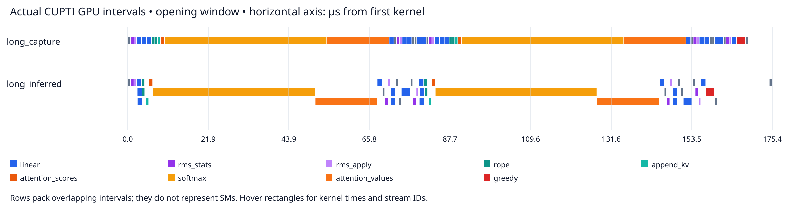
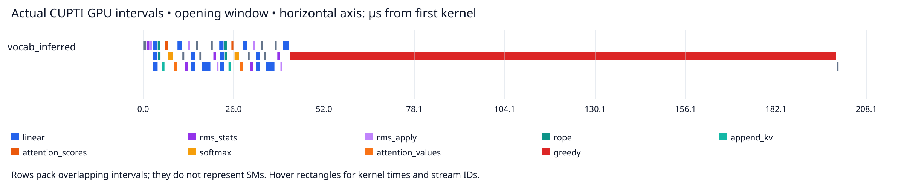
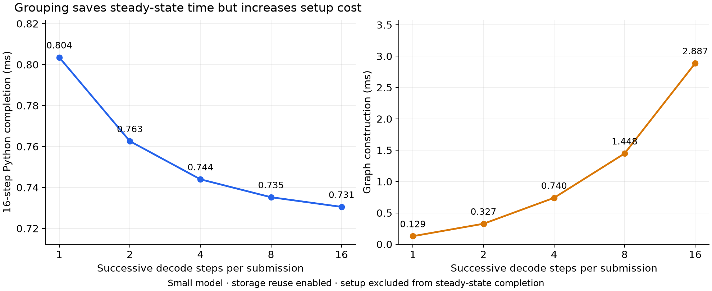

[Codebase for CKL](https://github.com/ppppqp/composable-kernel-language)

A GPU program often spends its life executing the same collection of kernels. Optimizing each kernel matters, but so do the decisions between kernels: which launches must wait, which branches can overlap, which temporary buffers can share storage, and how much work one host submission should represent.

CKL (Composable Kernel Language) is an experiment in making those decisions part of a small MLIR-based language. The compiler sees both device computation and the program composing it. It derives a dependency graph from memory effects, plans temporary storage against that graph, and produces a reusable execution plan.

# Kernel Composition Orchestration

Consider an imperative program that launches three kernels:

```text
A: update(input_a, temporary_a)
B: update(input_b, temporary_b)
C: combine(temporary_a, temporary_b, output)
```

If the resources used by A and B are known to be disjoint, their execution graph is:

```text
A ──┐
    ├──> C
B ──┘
```

The source gives a reference order, A then B then C. The graph preserves the dependencies required for equivalent execution while permitting A and B to run independently. However, since read and write to the same buffer can occur and thus creating race condition and unknown behavior, the compiler needs a model of effects and resource identity before removing ordering.

## Streams, CUDA Graphs, and compiler-derived dependencies

A CUDA stream gives operations an ordering. Multiple streams and events let the application express dependencies across streams. CUDA Graphs represent work and dependencies explicitly and support reusable execution. They can be constructed directly or recorded through stream capture([CUDA Graphs programming guide](https://docs.nvidia.com/cuda/cuda-programming-guide/04-special-topics/cuda-graphs.html)).

These mechanisms execute the dependencies supplied by the application. CKL's compiler work is to derive those dependencies from the program, aka construct an explicit graph whose edges come from effect and alias analysis,

The same distinction applies to many other kernel languages. A [Triton `@triton.jit` function](https://triton-lang.org/main/python-api/generated/triton.jit.html) provides a kernel compilation interface. Composing multiple launches also requires decisions about buffers, dependencies, and submission, often handled by Python or a surrounding framework (Pytorch). This is the boundary that this project wants to explore.

IREE is a useful reference for a more complete compiler architecture. Its [Stream dialect](https://iree.dev/reference/mlir-dialects/Stream/) makes resources, asynchronous work, timepoints, and command execution explicit between higher-level computation and the hardware abstraction layer. CKL builds smaller execution-planning layer with similar ideas.

## The benefit of kernel composition

There are several independent opportunities:

| Opportunity | What changes | Required evidence |
| --- | --- | --- |
| Dependency scheduling | Independent kernels become ready without unnecessary ordering | Complete effects and sound alias information |
| Temporary reuse | Different logical buffers share physical storage | All accesses to their lifetimes are ordered |
| Graph replay | A bound command graph is reused | Stable resources, arguments, and topology |
| Step grouping | Several complete iterations share one submission | Correct dependencies between iterations |
| Kernel fusion | Multiple device computations become one kernel | A transformation preserving computation and memory semantics |

Notice that those opportunities may conflict each other. Reusing storage must not introduce a race between previously independent branches. Grouping iterations must preserve dependencies through mutable state. Fusion changes the device computation and may change which memory operations exist at all. In CKL, we are primarily focusing on dependency scheduling and temporary reuse.

# Composable Kernel Language

There are already substantial compiler and runtime systems for this problem, including IREE. The initial question was whether a minimal set of MLIR interfaces and passes could make composition easier to add to a small GPU DSL. CKL is currently a self-contained language owning its kernels, program IR, ABI metadata, device lowering, and runtime handoff. Interfaces provide useful internal boundaries, but the repository does not currently implement a generic adapter for arbitrary external DSL kernels (because it would require excessive plumbing for custom runtime). However, the infrastructure and pattern (interfaces, analysis, transforms) should be able to be adopted by any MLIR-based DSL.

## Example program

Below is a small example of CKL program which contains one kernel used twice:

```python
import ckl

N = ckl.dim("N")
Vector = ckl.Buffer[ckl.f32, (N,)]

@ckl.kernel
def update(src: Vector, dst: Vector, bias: ckl.f32) -> None:
    i = ckl.global_id(0)
    if i < src.shape[0]:
        dst[i] = src[i] + bias

@ckl.program
def step(src: Vector, dst: Vector, bias: ckl.f32) -> None:
    temporary = ckl.empty_like(src)
    grid = (ckl.cdiv(src.shape[0], 256),)
    ckl.launch(update, src, temporary, bias, grid=grid, block=(256,))
    ckl.launch(update, temporary, dst, bias, grid=grid, block=(256,))

lowered = step.lower(signature={
    "src": ckl.BufferSpec((257,), ckl.f32),
    "dst": ckl.BufferSpec((257,), ckl.f32),
    "bias": ckl.f32,
})
```

A kernel describes device computation. A program describes allocation and composition (in other words, the "driver"). Here `temporary = src + bias`, followed by `dst = temporary + bias`. The length is specialized to 257, so each launch uses two blocks of 256 threads and explicitly guards excess threads. These patterns of repeatedly executed small kernels are pretty common in scientific computing, e.g. the [3D electromagnetic Finite-Difference Time-Domain](https://github.com/Jonah-E/FDTD).

## Architecture overview

The current pipeline has a shared preparation stage and separate host/device branches:

```text
Python kernel + program ASTs
    │  signature checking and specialization
    ▼
CKL IR + upstream arith/scf operations
    │  optional pointwise fusion
    │  ckl-prepare-cuda
    ├────────────────────────────────────────────┐
    ▼                                            ▼
ckl-build-graph                          ckl-lower-kernels-to-gpu
  ├─ recompute effect summaries                   │
  ├─ bind aliases and dispatch effects            ▼
  ├─ infer dependency graph                upstream GPU/NVVM lowering
  └─ attach static memory plan                    │
    │                                            ▼
    ▼                                           CUBIN
ckl-lower-graph-to-exec                           │
    │                                            │
    ▼                                            │
verified ckl_exec.plan + source signature ◄───────┘
    │  embed device bytes in a dedicated host module
    ▼
ckl-lower-exec-to-llvm
    │
    ▼
MLIR LLVM dialect → upstream translation → ExecutionEngine
    │
    ▼
JIT entry constructs a bound native plan
    │
    ▼
ordinary launches / captured graph / inferred graph
```


# Core Concepts and Implementation

## Basic operations

The operation definitions are in [`CKLOps.td`](https://github.com/ppppqp/composable-kernel-language/blob/main/include/ckl/Dialect/CKL/IR/CKLOps.td). TableGen generates their C++ classes, while handwritten verifiers enforce additional constraints.

| Operation | Inputs → outputs | Meaning and current scope |
| --- | --- | --- |
| `ckl.alloc` | Static memref result type → buffer | Compiler-owned device allocation |
| `ckl.free` | Buffer → none | End a compiler-owned resource lifetime |
| `ckl.load_element` | Buffer, one index per dimension → scalar | Indexed kernel read; constant indices expose one element, otherwise the whole operand |
| `ckl.store_element` | Scalar, buffer, indices → none | Indexed kernel write; constant indices expose one element, otherwise the whole operand |
| `ckl.thread_id`, `ckl.block_id` | Axis attribute → `index` | Thread/block coordinates |
| `ckl.block_dim`, `ckl.grid_dim` | Axis attribute → `index` | Block/grid dimensions |
| `ckl.global_id` | Axis attribute → `index` | `block_id * block_dim + thread_id` |
| `ckl.view` | Buffer → same-type buffer | Identity alias, without allocating or copying storage |
| `ckl.subview` | Buffer + static element offset → contiguous buffer view | Preserve base identity and expose a bounded byte range |
| `ckl.load`, `ckl.store` | Buffer/scalar → scalar/none | Whole-resource analysis operations retained in low-level fixtures |
| `ckl.atomic_rmw` | Value, buffer, ordering/scope → value | Atomic read/write effects for analysis |
| `ckl.sync` | Resources, scope → none | Synchronization and resource-ordering metadata for analysis |
| `ckl.dispatch` | Arguments, optional completion tokens, launch metadata → token | Schedulable kernel invocation |
| `ckl.graph` | Source function and graph metadata → region | Container for analyzed nodes, edges, and memory-plan attributes |

The analysis vocabulary is broader than the current CUDA device subset. Whole-resource loads/stores, `ckl.sync`, and `ckl.atomic_rmw` do not currently have executable CUDA lowering. In particular, a `ckl.sync` in an analysis fixture is not evidence that the backend implements a device barrier.


## Effects

Load reads memory, store mutates memory, and allocation/free change resource lifetimes. These operations imposes ordering to kernel execution. For example, a consumer reading a temporary must follow the producer that wrote it.

CKL builds on MLIR's `MemoryEffectOpInterface`. A shortened definition of an indexed load is:

```tablegen
def CKL_LoadElementOp : CKL_Op<"load_element", [AccessRegionOpInterface]> {
  let arguments = (ins
    Arg<AnyMemRef, "", [MemReadAt<0, FullEffect>]>:$resource,
    Variadic<Index>:$indices);
  let results = (outs AnyType:$value);
  let hasVerifier = 1;
}
```

The memory-effect annotation identifies a read associated with the resource operand. The custom access-region interface adds information about the portion of that resource affected. Combining the two annotation we are able to understand *what kind of access occurs*, and *where it may occur*.


`AccessRegionOpInterface` implementation is essentially calling the `getOperationAccessRegion` helper:

```cpp
/*
def AccessRegionOpInterface : OpInterface<"AccessRegionOpInterface"> {
  let cppNamespace = "::mlir::ckl";
  let methods = [
    InterfaceMethod<
      "Returns whole, unknown, or a byte interval relative to the accessed operand.",
      "::mlir::Attribute", "getAccessRegion",
      (ins "::mlir::Value":$resource), [{}], [{
        return ::mlir::ckl::getOperationAccessRegion($_op, resource);
      }]>
  ];
}
*/
Attribute mlir::ckl::getOperationAccessRegion(Operation *op, Value resource) {
  /*
  e.g. for ckl.load_element %r[%i, %j, %k], the access region is
  %i * stride[0] + %j * stride[1] + %k * stride[2] * sizeof(element)
  */
  auto type = dyn_cast<MemRefType>(resource.getType());
  StringRef name = op->getName().getStringRef();
  if (type && type.hasStaticShape() && type.getLayout().isIdentity() &&
      type.getElementType().isIntOrFloat() &&
      type.getElementType().getIntOrFloatBitWidth() % 8 == 0 &&
      (name == "ckl.load_element" || name == "ckl.store_element")) {
    unsigned begin = name == "ckl.load_element" ? 1 : 2;
    int64_t linear = 0;
    for (int64_t axis = 0; axis < type.getRank(); ++axis) {
      // Compute the linear index of the accessed element. If any of the indices are
      // not constant, or out of bounds, return "whole" to indicate that the entire
      // resource may be accessed.
      APInt index;
      if (!matchPattern(op->getOperand(begin + axis), m_ConstantInt(&index)))
        return StringAttr::get(op->getContext(), "whole");
      int64_t i = index.getSExtValue(), extent = type.getDimSize(axis);
      if (i < 0 || i >= extent || linear > (std::numeric_limits<int64_t>::max() - i) / extent)
        return StringAttr::get(op->getContext(), "whole");
      linear = linear * extent + i;
    }
    int64_t bytes = type.getElementType().getIntOrFloatBitWidth() / 8;
    if (bytes && linear <= std::numeric_limits<int64_t>::max() / bytes)
      return byteRange(op->getContext(), linear * bytes, bytes);
  }
  return StringAttr::get(op->getContext(), "whole");
}
```

Constant indexed loads and stores expose a one-element byte interval; other indexed accesses conservatively cover the operand. The result is an `Attribute`: `"whole"`, `"unknown"`, or a dictionary containing `offset` and `length` in bytes. Analysis composes these regions through supported contiguous subviews and merges multiple accesses into a conservative enclosing interval.

### Summarizing a kernel

[`EffectAnalysis.cpp`](https://github.com/ppppqp/composable-kernel-language/blob/main/lib/Analysis/EffectAnalysis.cpp) contains `SummaryAnalysis` and `SummarizeEffectsPass`. For the example kernel, the logical summary is:

```text
update(src, dst, bias):
  src  → read, whole buffer
  dst  → write, whole buffer
  bias → no memory effect
```

The corresponding generated attribute has this shape (reformatted for readability):

```mlir
ckl.effect_summary = {
  accesses = [
    {arg = 0 : i64, effects = ["read"], region = "whole"},
    {arg = 1 : i64, effects = ["write"], region = "whole"}
  ],
  may_alias = [[0, 1]],
  ordering_scopes = [],
  synchronizes = false,
  unknown = false
}
```

`may_alias = [[0, 1]]` records that the two buffer arguments may overlap when bound by a caller. The scalar bias has no resource access entry. This summary describes the kernel in terms of formal arguments; each dispatch still needs to substitute its actual buffers.

The implementation walks the body and nested regions, obtains memory-effect instances, resolves each accessed value to a base resource, and accumulates effects for the corresponding formal argument. It handles calls interprocedurally by summarizing the callee, substituting actual arguments for formal arguments, then accumulating those effects in the caller. Effects on recognized local allocations are excluded from the outward argument summary.


```cpp
if (auto interface = dyn_cast<MemoryEffectOpInterface>(operation)) {
  SmallVector<MemoryEffects::EffectInstance> effects;
  interface.getEffects(effects);
  // For each effect, classify its kind and resolve its resource.
}

if (auto regionInterface = dyn_cast<AccessRegionOpInterface>(operation)) {
  Attribute region = regionInterface.getAccessRegion(value);
  // Compose through supported views and merge into the argument summary.
}
```

The summary will be later used by `ckl-build-graph` from `deriveEffectSummaries` to build the execution graph.

## Aliasing Analysis

Two SSA values can refer to the same underlying allocation:

```mlir
%base = "ckl.alloc"() : () -> memref<16xf32>
%alias = "ckl.view"(%base) : (memref<16xf32>) -> memref<16xf32>
```

A write through `%alias` conflicts with a subsequent read through `%base`. Comparing SSA names would miss that dependency. [`getBaseResource`](https://github.com/ppppqp/composable-kernel-language/blob/main/lib/Core/MemoryEffects.cpp) follows `ViewLikeOpInterface` back to the original resource:

```cpp
Value getBaseResource(Value value) {
  SmallPtrSet<Operation *, 8> visited;
  while (Operation *definition = value.getDefiningOp()) {
    if (!visited.insert(definition).second)
      break;
    auto view = dyn_cast<ViewLikeOpInterface>(definition);
    if (!view)
      break;
    value = view.getViewSource();
  }
  return value;
}
```

`ckl.view` supplies `getViewSource()` and preserves its operand's type. It has no offset, shape, or stride operands; it is an identity alias. Upstream view-like operations, including subviews, can also be traced to their base resource for whole-buffer analysis.

The alias classification is pretty lean, basically by normalizing a resource reference to its base resource.

```cpp
lhs = getBaseResource(lhs);
rhs = getBaseResource(rhs);
if (lhs == rhs)
  return WholeBufferAliasResult::MustAlias;
if (isAllocationValue(lhs) || isAllocationValue(rhs))
  return WholeBufferAliasResult::NoAlias;
return WholeBufferAliasResult::MayAlias;
```

After normalization, identical resources must alias. Distinct recognized allocations have fresh identities. Distinct external arguments may alias: a caller can pass overlapping ranges (although this is not common). The graph preserves conflicts for both `MustAlias` and `MayAlias` unless proven disjoint access regions allow it to remove a memory hazard.

### Subviews

Base-resource aliasing alone cannot distinguish disjoint slices of one buffer. `ckl.subview` adds that precision without allocating or copying, so that it provides fine-grained analysis and opens more opportunity for parallelism. Its offset is a constant number of source elements, and its result has a static contiguous shape. For example, using the `update` kernel defined earlier:

```python
@ckl.program
def split_update(storage: Vector, output: Vector) -> None:
    left = ckl.subview(storage, offset=0, shape=(32,))
    right = ckl.subview(storage, offset=32, shape=(32,))
    ckl.launch(update, left, left, 1.0, grid=(1,), block=(32,))
    ckl.launch(update, right, right, 2.0, grid=(1,), block=(32,))
    ckl.launch(update, storage, output, 0.0, grid=(1,), block=(64,))

lowered = split_update.lower(signature={
    "storage": ckl.BufferSpec((64,), ckl.f32),
    "output": ckl.BufferSpec((64,), ckl.f32),
})
```

Both slices normalize to `storage`, so their base resources are `MustAlias`. Their accesses occupy disjoint half-open byte intervals: `left` covers `[0, 128)` and `right` covers `[128, 256)`. The compiler therefore omits the memory-conflict edge between the first two launches.

Static contiguous CKL subviews are supported through execution: executable argument descriptors retain verified `byte_offset` and `byte_length` fields, and host packing adds the offset to the base pointer. Kernels index from zero within the view. Dynamic/strided slices and unmodeled upstream views remain outside executable support. Temporary subviews keep the base allocation's lifetime and storage-planning identity; they do not become separate allocations.

## Graph planning

[`BuildGraphPass`](https://github.com/ppppqp/composable-kernel-language/blob/main/lib/Analysis/GraphAnalysis.cpp) first binds each dispatch's formal kernel effects to its actual resources. In the example:

```text
launch 0: read(src),       write(temporary)
launch 1: read(temporary), write(dst)
```

The write/read conflict on `temporary` creates a producer-to-consumer edge. The frontend emits completion tokens but does not automatically chain every dispatch through them, so memory effects supply the ordering here.

For potentially aliasing resources, the basic hazards are:

| Earlier access | Later access | Required ordering |
| --- | --- | --- |
| Read | Read | No memory-conflict edge |
| Write | Read | Preserve the produced value: RAW |
| Read | Write | Prevent overwrite before consumption: WAR |
| Write | Write | Preserve write order: WAW |
| Allocate/free | Conflicting access | Preserve resource lifetime |

The graph builder compares earlier/later node pairs and their bound accesses. Its memory-conflict decision is essentially:

```cpp
WholeBufferAliasResult alias = aliasWholeBuffers(lhs.resource, rhs.resource);
if (alias == WholeBufferAliasResult::NoAlias ||
    !hasConflictingAccesses(lhs.bits, rhs.bits))
  continue;
bool lifetime = ((lhs.bits | rhs.bits) & (Allocate | Free)) != 0;
if (!lifetime && alias == WholeBufferAliasResult::MustAlias &&
    areDisjointAccessRegions(lhs.region, rhs.region))
  continue;
// Add an edge and retain its reason.
```

There are more edges than memory hazards. For example, the sequence also needs to consider explicit completion tokens, SSA-producing resource operations, allocation/free effects, etc.

For the vector example, an abbreviated view is:

```text
allocate temporary
        │
        ▼
launch 0: src → temporary
        │  RAW on temporary
        ▼
launch 1: temporary → dst
        │
        ▼
free temporary
```

More edges may be present in the full analysis, including transitive lifetime constraints. [`GraphAlgorithms.cpp`](https://github.com/ppppqp/composable-kernel-language/blob/main/lib/Analysis/GraphAlgorithms.cpp) preserves reachability between dispatches while reducing their executable predecessor lists. Allocation/free nodes do not need to become CUDA kernel nodes, but their ordering constraints must survive that projection.

## Storage planning: reuse follows graph order

A sequential source interval is insufficient to prove that storage can be recycled. Two branches may appear one after another in the source yet execute concurrently in the inferred graph.

Let `U(A)` be the complete set of dispatch nodes whose inferred effects access resource A. The graph-to-planner bridge collects those dispatch users; reachability is computed over the graph, which also contains lifetime nodes. CKL permits A to precede B for reuse only if:

```text
for every a in U(A) and every b in U(B):
    a != b and there is a dependency path a → b
```

If one user of A can still execute alongside a user of B, they cannot share a slot. A valid ordered example is:

```text
allocate A → produce A → consume A → free A
                                         │
                                         ▼
                              allocate B → produce B → consume B → free B
```

The implementation in [`MemoryPlanner.cpp`](https://github.com/ppppqp/composable-kernel-language/blob/main/lib/Core/MemoryPlanner.cpp) computes transitive reachability using Floyd–Warshall and checks all user pairs. This is a straightforward cubic-time closure with quadratic storage, appropriate for the current small graphs rather than a claim of scalable optimal allocation.

The allocator greedily considers compatible slots and chooses the one with the least size growth. A shared slot grows to accommodate its largest resident and required alignment. Slots are packed into heaps by device and address space. External buffers are not allocated by the plan; persistent resources are excluded from recycling. A temporary must be ordered before or after every existing resident of the slot.

The important invariant is that storage planning does not add dependencies to force reuse. It preserves graph topology. If serialization could trade concurrency for a smaller heap, that would be a separate optimization requiring measurement.

The report retains baseline bytes, planned bytes, assignments, and reuse reasons. Dynamic shapes or unsupported layouts produce an unavailable plan with a diagnostic reason instead of an invented byte count.

# From Analysis to Execution

## A verified executable plan

[`LowerGraphToExecPass`](https://github.com/ppppqp/composable-kernel-language/blob/main/lib/Transforms/ExecutablePlan.cpp) establishes the ABI from memory plan:

1. Identify one backend and project graph dependencies onto dispatch nodes.
2. Materialize heaps and named external/temporary resource bindings.
3. Convert logical arguments into physical ABI slots.
4. Emit kernels with explicit launch geometry, artifact identity, ABI, and predecessor IDs.

The [`ckl_exec` dialect](https://github.com/ppppqp/composable-kernel-language/blob/main/include/ckl/Dialect/Exec/IR/CKLExecOps.td) makes these decisions inspectable:

| Operation | Responsibility |
| --- | --- |
| `ckl_exec.plan` | Own a backend-ready plan and reference the source signature |
| `ckl_exec.heap` | Declare heap bytes, alignment, device, and address space |
| `ckl_exec.resource` | Bind an external argument or a temporary heap slice |
| `ckl_exec.kernel` | Describe physical arguments, launch geometry, artifact, ABI, and dependencies |

A schematic resource/argument mapping for the vector program is:

```text
arg0                 → external src pointer
arg1                 → external dst pointer
arg2                 → f32 bias bytes
heap0 + offset 0     → temporary, 257 × sizeof(f32) bytes

kernel 0 arguments  → src, temporary, bias
kernel 1 arguments  → temporary, dst, bias
kernel 1 depends on → kernel 0
```

In the generated vector plan, the temporary's logical size is 1,028 bytes. The current graph planner uses 256-byte allocation alignment, so its heap is 1,280 bytes. The real heap operation is:

```mlir
"ckl_exec.heap"() <{
  address_space = "global", alignment = 256 : i64,
  bytes = 1280 : i64, device = 0 : i64, id = 0 : i64
}> : () -> ()
```

The second dispatch's predecessor list is `dependencies = array<i64: 1>`: the first dispatch has graph node ID 1 because the allocation occupies node 0. Executable kernel IDs retain their graph identities rather than being renumbered densely after lifetime nodes are removed.

## Device lowering and optional fusion

`ckl-prepare-cuda` validates the kernel subset and assigns device, artifact, implementation, and ABI metadata. `ckl-lower-kernels-to-gpu` clones kernel bodies into a GPU module and replaces CKL indexed accesses and coordinates with upstream memref/GPU operations. The upstream GPU-to-NVVM pipeline then produces a CUBIN.

## Host lowering and the JIT lifecycle

[`ExecToLLVM.cpp`](https://github.com/ppppqp/composable-kernel-language/blob/main/lib/Transforms/ExecToLLVM.cpp) implements `ckl-lower-exec-to-llvm`. It consumes a dedicated host module containing one executable plan, its source function declaration, and an embedded binary attribute. It emits MLIR LLVM operations; upstream translation produces LLVM IR for `ExecutionEngine`.

The generated entry has the conceptual ABI:

```cpp
void ckl_entry(void *frame, void **arguments);
```

It calls runtime helpers in a defined order:

```text
ckl_begin              load/cache the embedded device module
ckl_heap               allocate each planned temporary heap
ckl_resource           bind external pointers and heap slices
ckl_kernel             begin a launch description
ckl_argument_resource  append a physical resource pointer
ckl_argument_value     append physical scalar bytes
ckl_dependency         append predecessor IDs
ckl_commit             add the completed node to the bound plan
```

The generated entry runs during `bind()`. It constructs a plan; it does not launch the kernels. Subsequent `run()` and `benchmark()` calls use that bound plan and its cached graphs. This separates setup cost from repeated execution.

The public Python runtime wrappers use nanobind-backed native objects and support context managers:

```python
with lowered.compile(target=target, fuse_pointwise=False) as program:
    with program.bind(src, dst, bias) as invocation:
        invocation.run(mode="ordinary")
        invocation.run(mode="capture")
        invocation.run(mode="graph")
```

Here `target`, `src`, `dst`, and `bias` are already configured. Native shared ownership keeps programs, modules, buffers, and imported storage alive for a bound invocation. Closing a public wrapper prevents new operations through it; it does not invalidate resources still retained by another native object. Explicit `close()` is idempotent, and context exit also closes the wrapper.

The MLIR Python execution engine owns the host JIT. Its registered runtime-symbol references retain the host module/context through engine destruction. The small `ctypes.c_void_p` adapter in `_jit.py` wraps addresses for the upstream engine's registration API; CKL's runtime API itself is exposed through nanobind rather than manually declared ctypes calls.

## Constructing and replaying a CUDA graph

[`NvidiaRuntime.cpp`](https://github.com/ppppqp/composable-kernel-language/blob/main/lib/Runtime/NvidiaRuntime.cpp) implements three execution paths over the same native kernel plan:

- **Ordinary:** loop through nodes in topological order and call `cuLaunchKernel` on one stream.
- **Capture:** begin stream capture, record those ordinary launches, end capture, and instantiate the captured graph.
- **Inferred graph:** create a CUDA graph, add a kernel node for each plan node with its explicit predecessor handles, then instantiate it.

The essential explicit-graph construction is:

```cpp
for (const NvidiaPlan::Node &node : plan.nodes()) {
  std::vector<CUgraphNode> dependencies;
  for (auto predecessor : node.dependencies)
    dependencies.push_back(state->nodes.at(predecessor));

  // Populate CUDA_KERNEL_NODE_PARAMS from this node's launch and packed arguments.
  CUgraphNode graphNode{};
  check(cuGraphAddKernelNode(&graphNode, state->graph,
                            dependencies.data(), dependencies.size(), &parameters),
        "cuGraphAddKernelNode");
  state->nodes.push_back(graphNode);
}
check(cuGraphInstantiate(&state->executable, state->graph, 0), "cuGraphInstantiate");
```

The result is a reusable `CUgraphExec`; replay uses `cuGraphLaunch` on the invocation's stream. The runtime does not rerun alias analysis or storage planning during replay.


# Evaluation

We conducted a small decoder benchmark to see whether CKL can improve a complete, evolving GPU workload by changing its execution plan while keeping the device computation fixed.

## Workload and measurement design

Each sample generates 16 successive tokens per request. Every step runs embedding, RMSNorm, Q/K/V projections, RoPE, KV-cache updates, causal attention, an MLP, final normalization, vocabulary projection, greedy selection, token feedback, and device-side position advancement. The selected token feeds the next step, and the attention context grows throughout the sequence. This exercises a complete autoregressive computation rather than repeatedly timing a kernel with a fixed position. The recorded kernels use FP32 and straightforward serial per-thread dot products/reductions (so no tensor core/flash attention).

The machine was an NVIDIA RTX 5060 Ti with 16 GB, driver 595.91.07, CUDA toolkit 12.8, and a Release CKL build targeting `sm_120/+ptx87`. Below are the different cases used in the experiment:

| Case | Batch / initial context | Hidden / heads / layers | FFN / vocabulary | Dispatches per step |
| --- | ---: | ---: | ---: | ---: |
| small | 1 / 8 | 64 / 4 / 2 | 128 / 256 | 48 |
| awkward | 3 / 3 | 48 / 3 / 1 | 80 / 129 | 27 |
| long_context | 1 / 512 | 64 / 4 / 2 | 128 / 256 | 48 |
| wide | 1 / 8 | 256 / 8 / 2 | 512 / 2048 | 48 |
| deep | 1 / 8 | 64 / 4 / 8 | 128 / 256 | 174 |
| large_vocab | 1 / 8 | 64 / 4 / 2 | 128 / 8192 | 48 |
| large_batch | 64 / 64 | 64 / 4 / 2 | 128 / 256 | 48 |
| batch4 | 4 / 8 | 64 / 4 / 2 | 128 / 256 | 48 |
| wide_batch4 | 4 / 8 | 256 / 8 / 2 | 512 / 2048 | 48 |

`long_context`, `deep`, and `large_vocab` each change one field from `small`. `wide` changes hidden size, heads, FFN, and vocabulary together, so it demonstrates a larger configuration rather than isolating width scaling. The awkward dimensions exercise guards and nonuniform shapes.

There are two timing surfaces. **Native stream time** uses CUDA events around a complete 16-step sequence and divides by 16; it includes GPU gaps caused by native submission. **Python generation completion** measures all 16 steps, with one synchronous call per step or group. Graph setup is reported separately because it only matters for workloads that cannot reuse a bound graph many times.

## Separate submission, scheduling, and storage effects
Three approaches are measured against each case above:
- The ordinary baseline submits kernels in one native C++ burst per step. 
- Capture records those launches on one stream and replays their ordering. 
- Inferred execution constructs explicit edges from CKL's effect and alias analysis, allowing independent branches to become ready together. 
In addition, we performed grouping that repeats complete dependent decode steps inside a larger graph (e.g. decode the next N tokens in one cuda graph launch).

| Case | Ordinary µs/step | Capture | Inferred | Inferred, group 16 | Ordinary / inferred | Capture / inferred |
| --- | ---: | ---: | ---: | ---: | ---: | ---: |
| small | 62.08 | 54.82 | 46.71 | 45.40 | 1.33× | 1.17× |
| awkward | 34.93 | 28.01 | 24.58 | 23.06 | 1.42× | 1.14× |
| long_context | 177.08 | 171.64 | 163.60 | 161.91 | 1.08× | 1.05× |
| wide | 154.06 | 149.06 | 122.47 | 120.85 | 1.26× | 1.22× |
| deep | 230.72 | 194.67 | 162.48 | 161.76 | 1.42× | 1.20× |
| large_vocab | 215.23 | 209.68 | 201.58 | 200.22 | 1.07× | 1.04× |
| large_batch | 101.79 | 95.83 | 88.17 | 86.47 | 1.15× | 1.09× |
| batch4 | 63.67 | 55.31 | 47.47 | 46.14 | 1.34× | 1.17× |
| wide_batch4 | 159.40 | 154.15 | 128.48 | 126.72 | 1.24× | 1.20× |




The ordinary-to-capture comparison shows the value of graph replay with the original stream ordering. The capture-to-inferred comparison asks whether compiler-derived dependencies add value once replay is already available. It shows a further 1.04–1.22× speedup across these cases. For `small`, that is about 8 µs per step; for `wide`, about 27 µs. The eight-layer model repeats the scheduling opportunity through more layers and improves by 1.20× over capture.

These controls make the attribution more precise: CUDA Graph replay provides a general runtime benefit, while CKL supplies the less restrictive dependency graph. The next question is whether the GPU actually overlaps the independent work that graph exposes.

## GPU timelines: where inferred dependencies help

The following figures visualize recorded Nsight Systems CUDA activity. Each rectangle represents one kernel interval.



*Small model: capture reduces submission overhead but preserves serial kernel execution. The inferred graph exposes Q/K/V and gate/up projection overlap. Storage reuse preserves that overlap.*

Q, K, and V all read the normalized hidden state and write separate outputs. Their consumers need the appropriate results, but the three projections do not need to wait for one another. The gate and up projections have a similar relationship later in the MLP. The ordinary and captured traces contain no overlapping kernels; the inferred trace reaches three simultaneous kernel intervals, with at least two kernels active for 9.5% of its recorded GPU span.



*Wider model: independent projections last around 4 µs each, making their overlap more valuable than in the small configuration.*

For `wide`, summed kernel durations remain close between capture and inferred execution, while the union of their execution intervals becomes shorter. That supports scheduling overlap as the explanation for the improvement. The original kernels still execute; their device code has not become faster through fusion.

The trace counts provide another useful check:

| Small-model profile | Host kernel / graph launches | Kernel executions | Span with ≥2 kernels active | Maximum concurrent kernels |
| --- | ---: | ---: | ---: | ---: |
| Ordinary | 768 / 0 | 768 | 0.0% | 1 |
| Capture | 0 / 16 | 768 | 0.0% | 1 |
| Inferred | 0 / 16 | 768 | 9.5% | 3 |
| Inferred + reuse | 0 / 16 | 768 | 9.3% | 3 |
| Inferred, group 16 | 0 / 1 | 768 | 11.9% | 3 |

There are still 48 kernels × 16 steps in every row. Graph replay changes host submission count; inferred dependencies change legal scheduling; grouping reduces graph submissions further.


## Where orchestration stops helping

Long context and a large vocabulary expose bottlenecks inside individual kernels on the decode dependency path.


*Context 512: softmax dominates the recorded kernel work, limiting what projection overlap can save.*

In the historical long-context profile, `softmax` accounts for 54.9% of summed kernel time, or 89.1 µs per complete step. Its serial reduction must finish before attention can progress. CKL still exposes independent projections, but the capture-to-inferred improvement falls to about 5%.



*Vocabulary 8192: greedy selection becomes the dominant serial dependency before the next token can feed back.*

Here `greedy` accounts for 78.4% of summed kernel time, or 157.1 µs per complete step. The improvement over capture is only about 4%. These percentages describe summed profiled kernel durations, rather than fractions of unprofiled wall time, but they clearly identify where kernel work dominates.

This gives a concrete direction for compiler work: improve generic parallel reduction support and the CKL implementations of softmax and selection, then rerun the same unfused controls. The recorded measurements explain that motivation; they do not measure the effect of later reduction changes. Dependency scheduling cannot remove a serial reduction whose result the next stage needs.

## Storage reuse

| Case | Scratch without reuse | Scratch with reuse | Reduction |
| --- | ---: | ---: | ---: |
| small | 14,080 B | 3,072 B | 78.2% |
| wide | 47,360 B | 10,240 B | 78.4% |
| deep | 54,016 B | 3,072 B | 94.3% |
| large_batch | 1,017,088 B | 294,912 B | 71.0% |

The deep model is particularly illustrative. It has more layers and 174 dispatches per step, yet ordered temporary lifetimes let the planner reuse a small scratch heap across layers. Those savings exclude read-only weights and persistent KV caches, token history, and logits; they are not reductions in total model memory.

Matched ordinary, capture, and inferred controls show little timing change from reuse. For example, `small` inferred execution is 46.71 µs/step without reuse and 46.88 µs/step with it. This supports a memory-capacity benefit without claiming a latency improvement. The planner also preserves graph topology instead of inserting serialization to force additional reuse.

## Grouping steps

`group4_inferred` places four successive decode steps into one inferred graph submission. Each step consumes the token and updated state produced by the preceding step. It still generates one token per request per step; grouping changes how often the host submits work and observes completion.

| Steps per inferred submission, small model | Native µs/step | Python 16-step completion ms | Graph setup ms | Submissions per sequence |
| ---: | ---: | ---: | ---: | ---: |
| 1 | 46.88 | 0.804 | 0.129 | 16 |
| 2 | 45.81 | 0.763 | 0.327 | 8 |
| 4 | 45.60 | 0.744 | 0.740 | 4 |
| 8 | 45.49 | 0.735 | 1.448 | 2 |
| 16 | 45.40 | 0.731 | 2.887 | 1 |



The largest gains arrive by groups of two to four steps. Larger graphs give diminishing steady-state savings while increasing construction cost. Relative to a one-step inferred graph, grouping all 16 saves about 0.073 ms per sequence but adds about 2.758 ms of setup. Recovering that difference takes roughly 38 repeated sequences, assuming the same bound graph can be reused. Compilation and binding are outside that estimate. The deep model's 2,784-node grouped graph takes 11.16 ms to construct.

Comparing ordinary per-step calls with a 16-step inferred graph gives a 1.48× improvement in Python generation completion for `small` and 1.31× for `wide`. Those gains combine scheduling and fewer Python calls/completion waits. Tokens become host-visible after the group finishes, so this metric does not establish streamed inter-token latency or responsiveness to cancellation/EOS.


## Correctness and what the evidence supports

All timed native/Python sequences and all thirteen profiled sequences passed exact generated-token, complete-history, and position checks against an independent NumPy decoder. Final logits and full KV caches passed `atol=2e-5, rtol=3e-4`, with maximum absolute error 2.15e-06 across the report. Checks also protect immutable weights/metadata, prefilled KV prefixes, unused cache suffixes, and 256-element physical allocation tails. The trace analyzer checks expected kernel/submission counts, timestamps, known symbols, successful CUDA API returns, and absence of transfer/reset activity in the measured range.

The final collection completed without a retry. The report discloses an earlier exploratory four-request grouped-capture run that exited with status 139; its cause was not established, although the retry and final collection passed. That qualification belongs to the request diagnostic rather than being hidden behind the final successful run.

The strongest result is that compiler-derived dependencies improve complete autoregressive computation over single-stream graph capture, with unchanged unfused kernels, and that graph-aware storage planning reduces temporary memory without giving up that scheduling freedom. The traces explain the gains and also expose their limits when serial kernels dominate.
