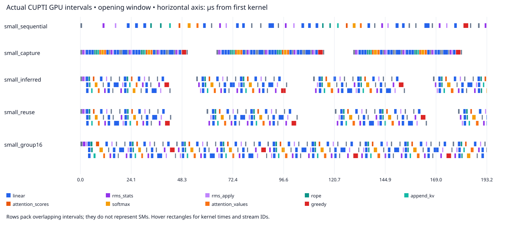
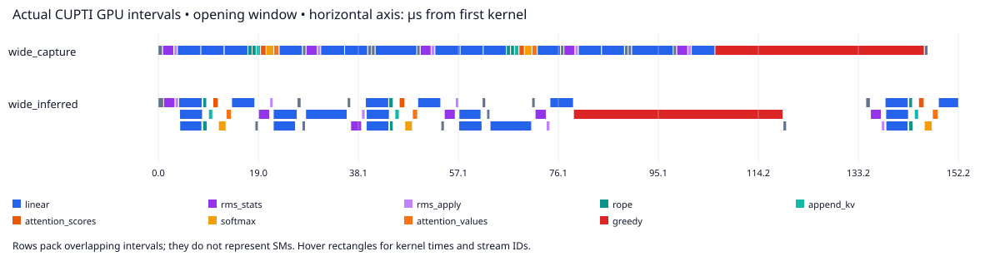
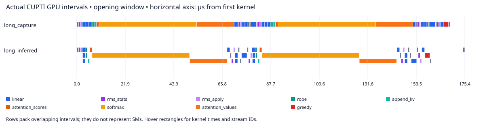
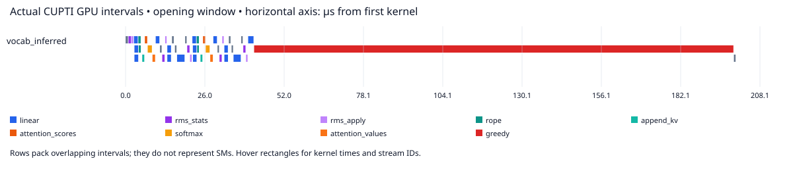
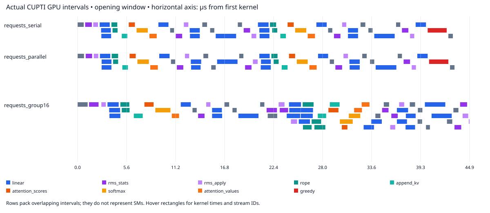

# Decoder deep dive: scheduling, kernel bottlenecks, and request concurrency

2026-10-17 · NVIDIA RTX 5060 Ti (16 GB) · Release CKL · FP32 · no kernel fusion

CKL improves complete autoregressive decoding with unchanged kernels. The traces show that inferred dependencies let Q/K/V and gate/up projections overlap. The effect survives a wider model and eight layers, but serial softmax and greedy selection sharply limit the gain at longer contexts and larger vocabularies. Storage reuse saves scratch memory without a material latency improvement. Separate request streams improve throughput over serialized requests; ordinary batching remains faster when four requests can share a batch.

[Full timing tables](matrix.md) · [raw timing samples](matrix.json) · [interactive GPU trace viewer](traces/viewer.html) · [trace statistics](traces/summary.json) · [exact capture commands](traces/manifest.json)

## What was measured

Each sample generates 16 successive tokens per request through embedding, all transformer layers, final RMSNorm, vocabulary projection, greedy selection, token feedback, and device-side position advance. The context grows each step. Weights are deterministic random values; this is a complete model computation, without a trained checkpoint or a text-quality test. The CKL kernels use serial per-thread dot products/reductions, with no tensor cores, optimized attention, or FP16.

Nine cases × fourteen execution variants were measured with seven samples and three warmup sequences. Samples rotate/reverse variant order. A separate request experiment covers two, four, and eight requests for the small/wide models, plus matched batch-four controls: eight configurations × eight execution variants. No GPU measurements or profiles ran concurrently with each other.

| Case | Batch / initial context | Hidden / heads / layers | FFN / vocabulary | Kernels per step |
|---|---:|---:|---:|---:|
| small | 1 / 8 | 64 / 4 / 2 | 128 / 256 | 48 |
| awkward | 3 / 3 | 48 / 3 / 1 | 80 / 129 | 27 |
| long_context | 1 / 512 | 64 / 4 / 2 | 128 / 256 | 48 |
| wide | 1 / 8 | 256 / 8 / 2 | 512 / 2048 | 48 |
| deep | 1 / 8 | 64 / 4 / 8 | 128 / 256 | 174 |
| large_vocab | 1 / 8 | 64 / 4 / 2 | 128 / 8192 | 48 |
| large_batch | 64 / 64 | 64 / 4 / 2 | 128 / 256 | 48 |
| batch4 | 4 / 8 | 64 / 4 / 2 | 128 / 256 | 48 |
| wide_batch4 | 4 / 8 | 256 / 8 / 2 | 512 / 2048 | 48 |

The `wide` preset scales hidden size, FFN, head count, and vocabulary together. Its speedup is evidence for a larger model configuration, not an isolated width-scaling result. `long_context`, `deep`, and `large_vocab` change one configuration field from `small`.

Native timings below are CUDA-event elapsed time per complete step across the 16-step sequence; they include GPU gaps caused by native submission. The ordinary baseline launches kernels in one native C++ burst, without per-kernel synchronization. Capture is actual single-stream CUDA capture. Inferred graphs use effect-derived dependencies. Python completion timing is separate and includes one synchronous call per step/group. Reset, prefill, copies, compilation, binding, and graph construction are excluded from steady-state measurements.

All variants disable pointwise fusion. The storage ablation verifies identical prepared kernel IR. The fourteen variants include the original six, ordinary/capture with reuse, and capture/inferred graphs grouping 2, 4, or 8 steps. Batched variants group all 16 steps.

## Unprofiled performance

| Case | Ordinary µs/step | Capture | Inferred | Inferred, 16-step graph | Ordinary / inferred | Capture / inferred |
|---|---:|---:|---:|---:|---:|---:|
| small | 62.08 | 54.82 | 46.71 | 45.40 | 1.33× | 1.17× |
| awkward | 34.93 | 28.01 | 24.58 | 23.06 | 1.42× | 1.14× |
| long_context | 177.08 | 171.64 | 163.60 | 161.91 | 1.08× | 1.05× |
| wide | 154.06 | 149.06 | 122.47 | 120.85 | 1.26× | 1.22× |
| deep | 230.72 | 194.67 | 162.48 | 161.76 | 1.42× | 1.20× |
| large_vocab | 215.23 | 209.68 | 201.58 | 200.22 | 1.07× | 1.04× |
| large_batch | 101.79 | 95.83 | 88.17 | 86.47 | 1.15× | 1.09× |
| batch4 | 63.67 | 55.31 | 47.47 | 46.14 | 1.34× | 1.17× |
| wide_batch4 | 159.40 | 154.15 | 128.48 | 126.72 | 1.24× | 1.20× |

The capture comparison isolates the benefit beyond reducing host launch calls. The small model gains about 8 µs/step over capture; the wide model gains about 27 µs/step because its independent projections run longer. The eight-layer model accumulates the same opportunity across more layers. Long context and vocabulary 8192 leave only about 5% and 4% improvement over capture, respectively.

Python generation completion improves by 1.48× for `small` and 1.31× for `wide` when comparing ordinary per-step calls with a 16-step inferred graph. This combines native scheduling and fewer Python calls/completion waits. It does not measure streamed token latency; grouped execution exposes tokens to the host after the group completes.

## What the GPU traces establish

Nsight Systems 2026.3.1 captured CUDA activity with `--cuda-graph-trace=node`. CUDA profiler API start/stop surround one warmed 16-step burst, with input resets and correctness readback outside the range. Each single-request trace contains exactly 768 kernel executions; each four-request trace contains 3072. Every recorded CUDA API succeeds, and the ranges contain no memcpy or memset activity.

These are separate diagnostic captures. Profiling increases API costs and gaps substantially: the small ordinary sequence spans about 2 ms in the trace, versus about 1 ms unprofiled. The following spans and gap statistics must not be used as benchmark speedups.

| Profile | Host kernel / graph launches | GPU kernel span µs | No-kernel gaps µs | Span with ≥2 kernels active | Max simultaneous kernels |
|---|---:|---:|---:|---:|---:|
| small_sequential | 768 / 0 | 1982.9 | 1208.1 | 0.0% | 1 |
| small_capture | 0 / 16 | 1069.6 | 351.2 | 0.0% | 1 |
| small_inferred | 0 / 16 | 921.7 | 322.8 | 9.5% | 3 |
| small_reuse | 0 / 16 | 950.2 | 349.8 | 9.3% | 3 |
| small_group16 | 0 / 1 | 728.7 | 126.5 | 11.9% | 3 |
| long_capture | 0 / 16 | 2922.3 | 325.7 | 0.0% | 1 |
| long_inferred | 0 / 16 | 2808.7 | 331.5 | 3.1% | 3 |
| wide_capture | 0 / 16 | 2550.5 | 317.0 | 0.0% | 1 |
| wide_inferred | 0 / 16 | 2131.8 | 319.1 | 13.0% | 3 |
| vocab_inferred | 0 / 16 | 3418.5 | 333.5 | 2.6% | 3 |
| requests_serial | 0 / 64 | 3838.9 | 1440.1 | 9.1% | 3 |
| requests_parallel | 0 / 64 | 2190.2 | 497.4 | 43.5% | 6 |
| requests_group16 | 0 / 4 | 1496.5 | 85.4 | 64.0% | 8 |

“GPU kernel span” runs from the first kernel start to the last kernel end. “No-kernel gaps” excludes the union of all recorded kernel intervals; overlap is wall time with at least two active intervals divided by that span. Neither quantity measures SM occupancy or achieved bandwidth. Maximum concurrency describes simultaneous kernel intervals. Visualization rows pack overlapping intervals and are not hardware SM assignments; original CUDA stream IDs remain in tooltips and portable trace arguments.

### Inferred dependencies expose useful parallelism



The ordinary/captured traces have no overlapping kernels. The inferred trace reaches three concurrent kernels. Its first layer shows the three Q/K/V projections on distinct CUDA streams, followed later by overlapping gate/up projections. This is the expected dataflow opportunity, with the original projection kernels preserved. Storage reuse retains that overlap.



For the wide trace, independent projections last around 4 µs each. Overlap removes considerably more elapsed work than in the small model. Summed kernel durations remain close between capture and inferred execution, while their interval union becomes shorter. This supports scheduling overlap as the explanation for the measured gain; it is not evidence of faster device code or fused kernels.

### Long-context and vocabulary bottlenecks are inside kernels



**Context 512:** `softmax` accounts for 54.9% of summed kernel time (89.1 µs per complete step). Its serial reduction is on the decode dependency path. Inferred graphs still overlap independent projections, but cannot remove this work.

**Vocabulary 8192:** `greedy` accounts for 78.4% of summed kernel time (157.1 µs per complete step). Its serial reduction is on the decode dependency path. Inferred graphs still overlap independent projections, but cannot remove this work.



This is a concrete limit of this benchmark implementation: it would be premature to judge orchestration for a production model from its serial softmax/argmax bottlenecks. Generic reduction support, or better CKL implementations of those kernels, would make the next evaluation more informative without requiring cross-kernel fusion.

## Storage reuse and step grouping

| Case | Scratch without reuse | Scratch with reuse | Reduction |
|---|---:|---:|---:|
| small | 14,080 B | 3,072 B | 78.2% |
| deep | 54,016 B | 3,072 B | 94.3% |
| large_batch | 1,017,088 B | 294,912 B | 71.0% |

Storage reuse is useful for memory capacity. Its matched ordinary/capture/inferred controls show little change in timing; scratch is already small and these kernels do not benefit materially from the reduced allocation footprint. The wide model has 47,360 → 10,240 bytes of scratch. Read-only weights and persistent KV/history/logits are outside these heap totals.

| Steps per inferred submission, small model | Native µs/step | Python 16-step completion ms | Graph setup ms | Submissions per sequence |
|---:|---:|---:|---:|---:|
| 1 | 46.88 | 0.804 | 0.129 | 16 |
| 2 | 45.81 | 0.763 | 0.327 | 8 |
| 4 | 45.60 | 0.744 | 0.740 | 4 |
| 8 | 45.49 | 0.735 | 1.448 | 2 |
| 16 | 45.40 | 0.731 | 2.887 | 1 |

Grouping yields diminishing returns after 2–4 steps and delays host observation. In this run, the additional setup cost of the small 16-step graph would take roughly 38 repeated 16-step sequences to recover from its Python completion savings over a one-step inferred graph. That estimate excludes compilation/binding and assumes the bound graph can be reused across resets/requests of the same shape. The deep 2784-node graph costs 11.16 ms to construct, so setup must remain visible in any short-lived workload evaluation.

## Independent requests and the batching control

The request experiment shares the same physical read-only weights and RoPE table between invocations. Each invocation has a distinct prompt and owns tokens, position, history, KV cache, logits, and scratch. All shapes/contexts are uniform within a run. Serial execution completes all 16 steps for one request before the next; parallel execution releases persistent worker threads through a barrier to run native bursts on separate streams. ctypes releases the GIL. Completion latency includes barrier/wakeup costs; there are no per-token Python callbacks in either baseline. This is an explicit workload-level concurrency experiment, not compiler-inferred cross-request independence.

| Model / requests | Serial ordinary ms | Parallel ordinary ms | Parallel capture ms | Parallel inferred ms | Parallel inferred, group 16 ms | Inferred tokens/s, group 1 |
|---|---:|---:|---:|---:|---:|---:|
| small / 2 | 2.023 | 1.397 | 1.019 | 0.876 | 0.855 | 36,546 |
| small / 4 | 4.038 | 1.981 | 1.150 | 1.016 | 0.962 | 62,999 |
| small / 8 | 8.139 | 4.416 | 1.478 | 1.416 | 1.312 | 90,379 |
| wide / 2 | 4.971 | 2.678 | 2.505 | 2.067 | 2.054 | 15,484 |
| wide / 4 | 9.930 | 3.092 | 2.828 | 2.414 | 2.354 | 26,511 |
| wide / 8 | 19.925 | 5.376 | 3.221 | 2.776 | 2.608 | 46,117 |

Capture already receives most of the benefit from parallel request streams. Inferred dependencies provide a further improvement with the same streams, so the entire multi-request gain must not be attributed to CKL dependency inference. Increasing request count eventually increases latency and contention; this fixed-burst test does not establish an admission policy or a serving latency target.



Four concurrent small requests reach six simultaneous kernel intervals with per-step graphs, and eight with grouped graphs in these captures. Overlap occupies about 44% and 64% of the recorded GPU span, respectively. This supports the presence of cross-request execution overlap. Profiler overhead exaggerates submission-gap differences, so use the unprofiled table for performance.

Four uniform requests can also be combined into one batch. The matched controls use the same model dimensions, shared model values, initial context, and total of 64 generated tokens. Prompts are deterministic but differ between the two layouts; kernel loop counts and context growth are identical. All results use storage reuse:

| Model | Four independent streams, inferred ms | One batch of four, inferred ms | Four streams, 16-step graph ms | One batch, 16-step graph ms |
|---|---:|---:|---:|---:|
| small | 1.016 | 0.765 | 0.962 | 0.744 |
| wide | 2.414 | 2.073 | 2.354 | 2.049 |

Batching wins in both matched cases. Independent streams remain a useful option for separate or incompatible request groups, but these results do not justify replacing batching with one stream per request. A next experiment should use different context/shape buckets or arrival times to study that tradeoff.

## Validation, scope, and next work

All timed native/Python sequences and all thirteen profiled sequences passed exact token/history/position checks against the independent NumPy decoder. Full KV caches and final logits passed `atol=2e-5, rtol=3e-4`; maximum absolute error across this report is 2.15e-06. Checks also protect prefilled KV prefixes, unused cache suffixes, read-only weights/metadata, and 256-element physical allocation tails. The analyzer verifies the expected kernel and submission counts, timestamps, successful CUDA API return values, known CKL symbols, and absence of transfer/reset activity in the capture range.

Source hashes matched the measured scripts. Portable trace timestamps, embedded viewer data, SVG syntax, and report links were checked. Headless Firefox rendered all thirteen trace selections and exercised full-range/first-step controls and kernel filtering; Python syntax checks and `git diff --check` passed.

The final collection completed without a retry. An exploratory earlier run exited with status 139 during the four-request grouped capture; retrying it succeeded, and the entire final collection also succeeded. The cause was not established. All unprofiled request measurements passed throughout.

The GPU uses unlocked clocks and no isolation/reservation mechanism. Seven samples describe this machine/run and do not provide a cross-device confidence interval. Tiny random models and naive serial kernels limit external validity. There is no prefill benchmark, paged cache, GQA, continuous batching, early EOS, stochastic sampling, real serving traffic, or production-engine comparison. The request timings are burst-completion throughput, not request-arrival-to-first-token latency or streamed inter-token latency.

The evidence suggests three concrete next steps:

1. Add generic parallel reduction support and rewrite softmax/greedy selection in CKL, preserving this unfused ablation matrix. This addresses the measured critical bottlenecks rather than introducing fusion heuristics.
2. Explore an asynchronous invocation/completion interface with buffer lifetime and dependency safety, then measure mixed-shape/context request groups. The current thread-pool benchmark is a diagnostic, not a proposed serving runtime.
3. Keep one-step inferred graphs and storage reuse as the default evaluation path. Treat step grouping as an explicit completion/observation tradeoff, retaining setup costs and matched batching controls.

## Reproduction and retained artifacts

Use a Release CUDA-enabled CKL build, NumPy, and recent Nsight Systems. The local environment for this report was:

```bash
export PYTHONPATH=python
export CKL_NATIVE_LIBRARY=/tmp/ckl-standalone-bench/python/ckl/libCKLCompiler.so
export CUDA_CACHE_PATH=/tmp/ckl-decoder-cuda
export OPENBLAS_NUM_THREADS=1 OMP_NUM_THREADS=1
/home/qiping-pan/Documents/workspace/tilelang/.venv/bin/python benchmarks/decoder/collect.py \
  --toolkit /home/qiping-pan/Documents/workspace/llvm/cuda-12.8 \
  --nsys /usr/local/NVIDIA-Nsight-Compute-2026.3/host/target-linux-x64/nsys \
  --matrix --output benchmarks/decoder/results/local-deep-dive
python3 benchmarks/decoder/analyze.py benchmarks/decoder/results/local-deep-dive/traces
```

The Python executable above supplies NumPy; the workload does not import TileLang. Driver 595.91.07, CUDA toolkit 12.8, target `sm_120/+ptx87`; JSON records native/source hashes, target identity, all samples, graph topology, maximum errors, and graph setup costs. The initial six-case study remains in [the earlier report](../rtx5060ti.md).

The repository retains compressed portable traces (`traces/*.trace.json.gz`), SVGs, source-associated kernel maps, exact profile commands, aggregate statistics, and an offline interactive HTML viewer. Decompress a trace to open it in a Chrome/Perfetto-compatible viewer. Native `.nsys-rep` and SQLite exports are available locally under `traces/` and ignored by git; `collect.py` regenerates them. The analyzer records their SQLite hashes and rebuilds all retained visualizations.
